<p align="center">
  
</p>

<p align="center">
  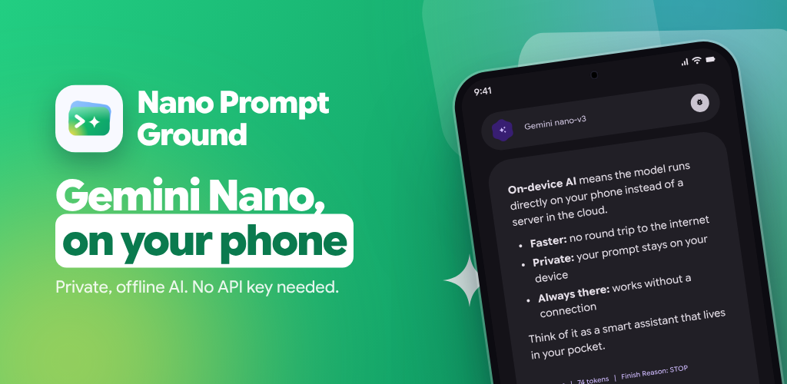
</p>

<p align="center">
  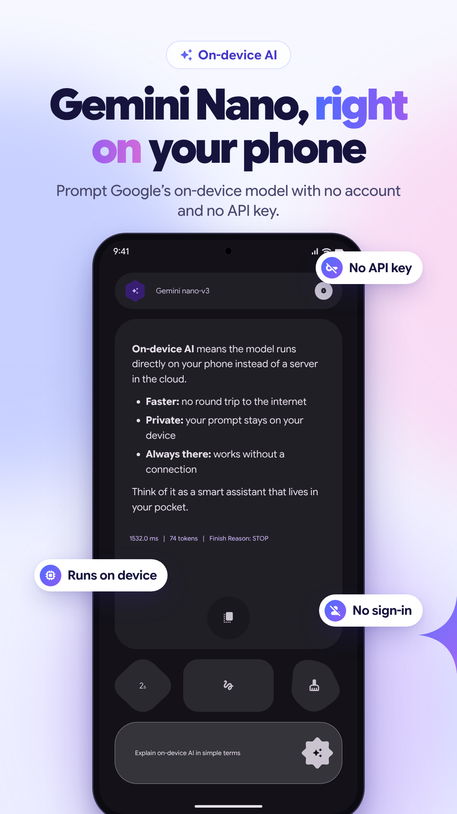
  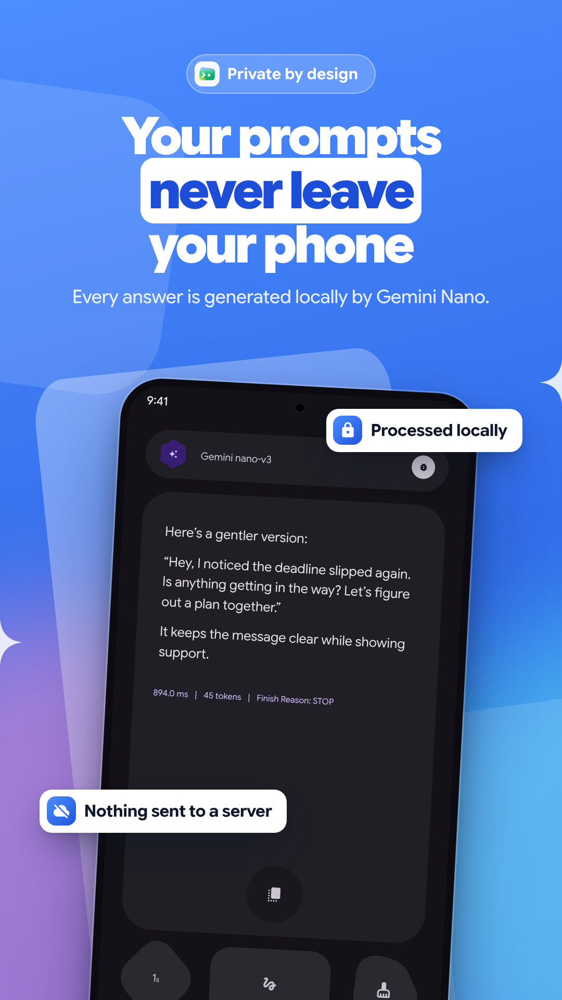
  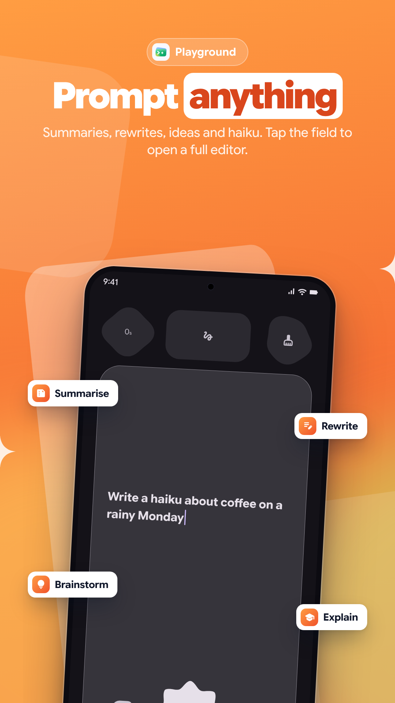
  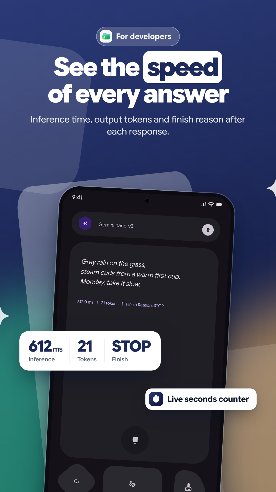
</p>
<p align="center">
  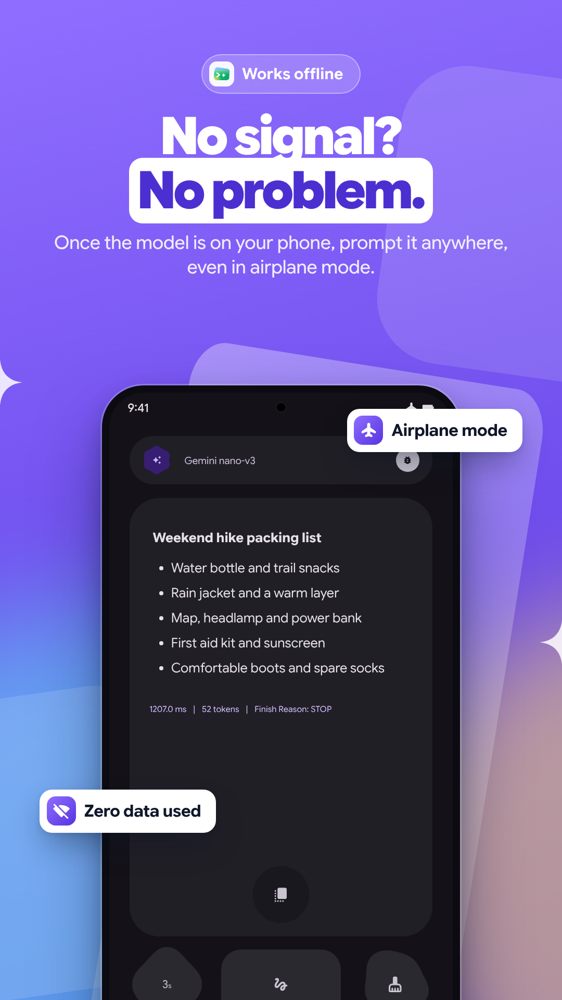
  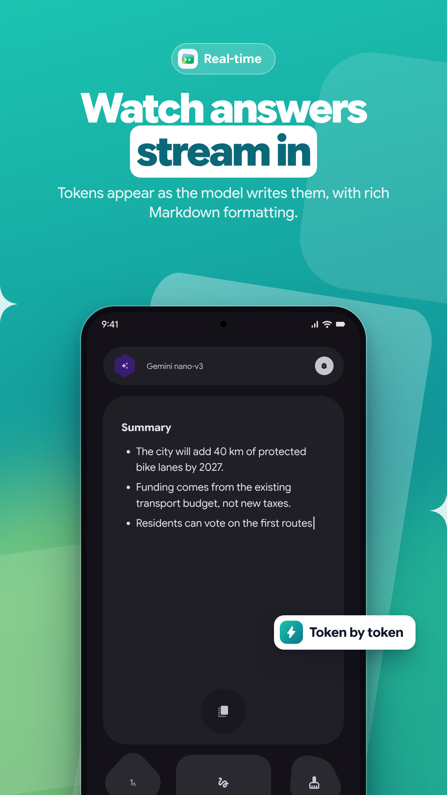
  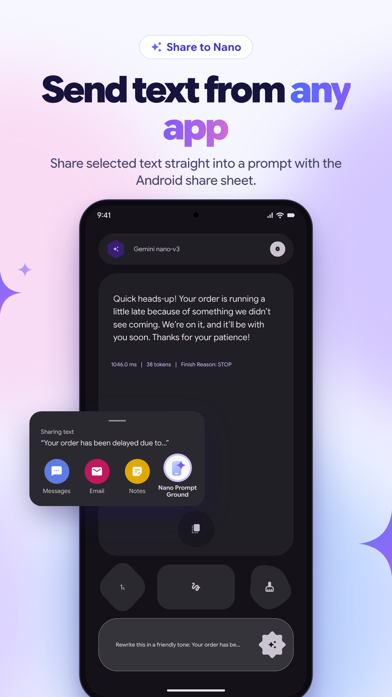
  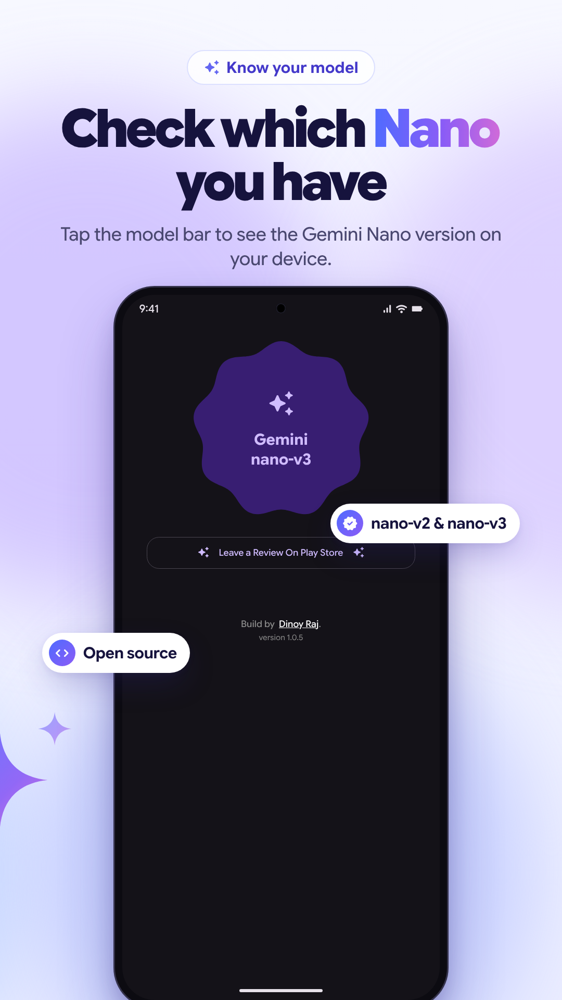
</p>


# Gemini Nano Playground

Nano Playground is an Android application designed to test and experiment with Google's on-device Generative AI model - Gemini Nano via ML Kit Prompt API(`com.google.mlkit:genai-prompt`)

## Install

Nano Playground is now available on Google Play!

<a href="https://play.google.com/store/apps/details?id=com.dino.nanoplayground">
  
</a>

> **Note:** Gemini Nano runs only on supported devices (see [Currently Supported Devices](#currently-supported-devices)). On first launch the app may need to download the model through AICore.

## Screenshots

**Tablet**

<p align="center">
  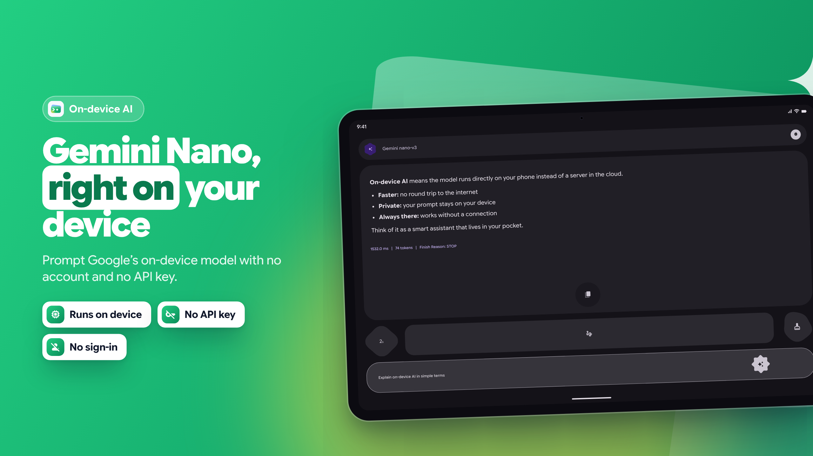
  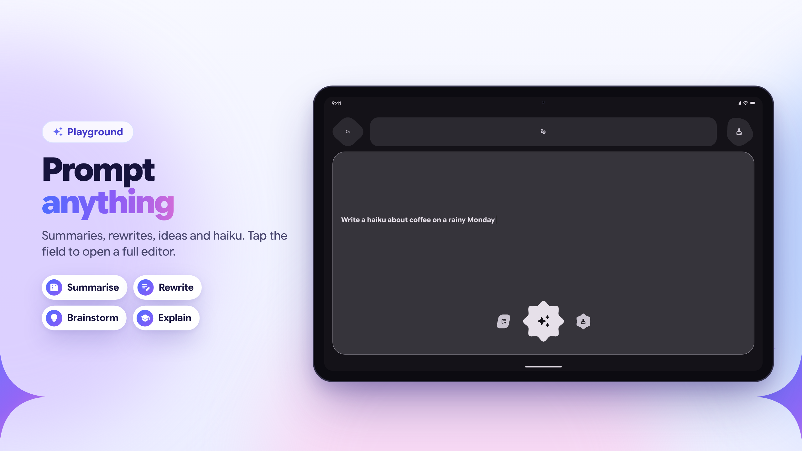
</p>

**Desktop**

<p align="center">
  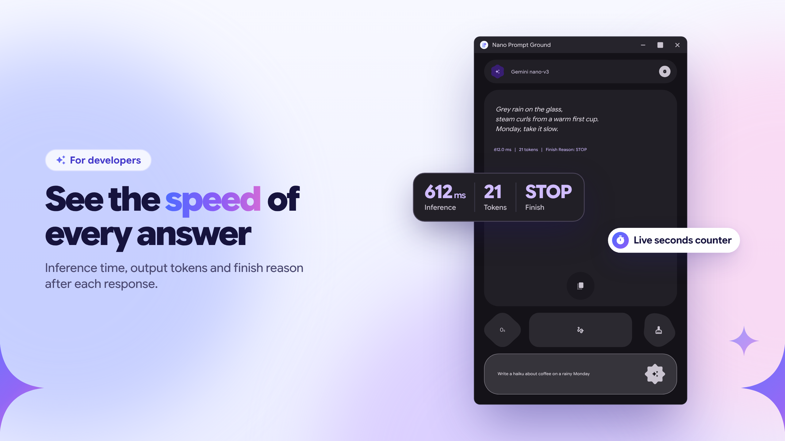
  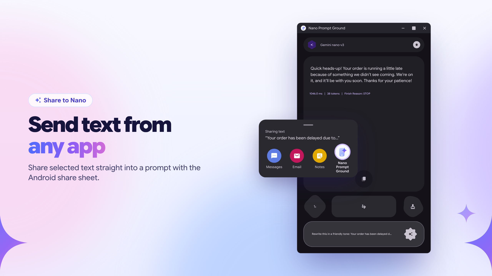
</p>

All store screenshots live in [`fastlane/metadata/android/en-US/images`](fastlane/metadata/android/en-US/images).


## Project Structure

```
.
├── .github/workflows
├── app
├── fastlane/metadata/android
├── gradle
├── release
├── store-listing
├── build.gradle.kts
├── gradle.properties
├── gradlew
├── gradlew.bat
├── LICENSE
├── README.md
└── settings.gradle.kts
```

The codebase is organized primarily within `app/src/main/java/com/dino/nanoplayground`:

```
app/src/main/java/com/dino/nanoplayground
├── core/
├── di/
├── ground/
│   ├── models/
│   └── ui/
│       ├── components/
│       ├── sections/
│       ├── viewmodel/
│       └── NanoGroundScreen.kt
├── info/
│   └── ui/
│       ├── components/
│       ├── sections/
│       └── InfoScreen.kt
├── navigation/
├── settings/
├── ui/
│   └── theme/
├── MainActivity.kt
└── NanoApplication.kt
```

*   **`core/`**: Core utilities such as custom Compose modifiers (`BounceEffect`), `AnimatedCounter`, navigation transitions and intent helpers.
*   **`di/`**: Hilt module (`NanoModule`) providing the ML Kit `GenerativeModel`.
*   **`ground/`**: The main feature module containing the UI and business logic.
    *   **`models/`**: Data classes representing application state (e.g., `HomeState`, `FeatureAvailability`).
    *   **`ui/`**: Compose UI components and screens.
        *   **`components/`**: Reusable UI elements like `ResponseContent`, `ChatOptions`, `HeaderInfoBar` and `UserQueryField`.
        *   **`sections/`**: Main screen layouts like `ChatScreen`, `FeatureStatusCheckingScreen`, `FeatureDownloadingScreen` and `FeatureUnAvailableScreen`.
        *   **`viewmodel/`**: Contains the `ChatViewModel` which handles the logic for checking model status and executing prompts.
*   **`info/`**: Info screen showing the Gemini Nano version, token limit, app version and a Play Store review tile.
*   **`navigation/`**: App navigation built with Navigation 3 (`MainNavigation`).
*   **`settings/`**: Settings screen (work in progress).
*   **`ui/theme/`**: Theme definitions for the application (colors, typography).

Outside the app module:

*   **`fastlane/metadata/android/en-US/`**: Google Play store listing (title, descriptions, app icon, feature graphic and phone, tablet and desktop screenshots).
*   **`store-listing/`**: Generator that renders the store screenshots and feature graphic from an HTML recreation of the app UI. See [`store-listing/README.md`](store-listing/README.md).


## Currently Supported Devices
[Supported Devices List](https://developers.google.com/ml-kit/genai#prompt-device)

**nano-v2**
*   **Google:** Pixel 9, Pixel 9 Pro, Pixel 9 Pro XL, Pixel 9 Pro Fold
*   **Honor:** Magic V5, Magic 7, Magic 7 Pro
*   **iQOO:** iQOO 13
*   **Motorola:** Razr 60 Ultra, Razr Ultra 2025
*   **OnePlus:** OnePlus 13, OnePlus 13s
*   **OPPO:** Find N5
*   **POCO:** POCO F7 Ultra, POCO F8 Pro, POCO F8 Ultra, POCO X7 Pro, POCO X8 Pro
*   **realme:** realme GT 7 Pro
*   **Samsung:** Galaxy Z Fold7, Galaxy Z TriFold
*   **Xiaomi:** Xiaomi 14T Pro, Xiaomi 15, Xiaomi 15T, Xiaomi 15T Pro, Xiaomi 15 Ultra, Xiaomi 17, Xiaomi 17 Ultra, Xiaomi Pad Mini
*   **vivo:** vivo X200 FE, vivo T4 Ultra

**nano-v3**
*   **Google:** Pixel 10, Pixel 10 Pro, Pixel 10 Pro XL, Pixel 10 Pro Fold
*   **Honor:** Honor Magic 8 Pro
*   **iQOO:** iQOO 15
*   **Samsung:** Galaxy S26, Galaxy S26+, Galaxy S26 Ultra
*   **Motorola:** Signature
*   **OnePlus:** OnePlus 15, OnePlus 15R
*   **OPPO:** Find X9, Find X9 Pro, Find X8, Find X8 Pro, Reno 14 Pro 5G, Reno 15 Pro 5G, Reno 15 Pro Mini 5G, Reno 15 Pro Max 5G
*   **realme:** realme GT 7T
*   **vivo:** vivo X200T, vivo X200, vivo X200 Pro, vivo X300, vivo X300 Pro

## Features

* **Model Status Checking**: Automatically checks the availability and download status of the required on-device models before allowing interaction, with download progress and clear error screens (unsupported device, AICore connection error, generic errors).
* **Chat Interface**: A streamlined chat UI built with Jetpack Compose, featuring expandable input fields and markdown rendering for AI responses.
* **Streaming Responses**: Responses are streamed token by token using `generateContentStream` for a responsive "typing" feel.
* **Inference Stats**: Shows inference time, response token count and finish reason once a response completes.
* **Share to Nano**: Share any text from another app to Nano Playground to use it as a prompt.
* **Model Info**: Displays the Gemini Nano version and token limit of the on-device model.
* **Animated UI**: Utilizes Compose animations, including shared element transitions and bounce effects, for a smooth user experience.
* **Clear Model Cache**: Includes a dedicated Material 3 dialog to safely clear the least recently used (LRU) static prompts and model data, helping manage on-device storage efficiently.
* **In-App Updates**: Uses Google Play In-App Updates to keep the app up to date.


## Upcoming Features

* **Multimodality Support**: Expanding capabilities to include image and document processing alongside text-based interactions.
* **Prefix Caching**: Implementation of prefix caching to significantly reduce latency and compute costs for repetitive prompt structures.
* **Model Configuration Settings**: Granular control over generation parameters, including **Temperature**, **Top-K**, **Top-P**, and **Random Seed**.
* **Offline Storage for Caching**: Persistent local storage support for prefix-cached prompts to ensure performance gains across app sessions.


## Tech Stack

This project is built using modern Android development practices and libraries:

*   **Kotlin**: The primary programming language.
*   **Jetpack Compose**: For building the native user interface.
*   **Hilt**: Dependency injection framework for managing application components.
*   **Google ML Kit GenAI**: Provides the on-device generative AI models and inference capabilities.
*   **Material Design 3**: For styling and UI components.
*   **Navigation 3**: For navigating between screens.
*   **Compose Markdown**: For rendering markdown responses.
*   **Google Play In-App Updates**: For prompting users to update the app.
*   **SplashScreen API**: For the app launch screen.
*   **Coroutines & Flows**: For asynchronous programming and state management.


## Architecture

The application follows the Model-View-ViewModel (MVVM) architecture pattern:
*   **View**: Jetpack Compose screens (`NanoGroundScreen`, `ChatScreen`) observe state from the ViewModel and handle user interactions.
*   **ViewModel**: `ChatViewModel` manages the state (`HomeState`), interacts with the `GenerativeModel`, and exposes data streams (`MutableStateFlow`, `StateFlow`) to the UI.
*   **Model**: The ML Kit `GenerativeModel` is provided through Hilt (`NanoModule`) and injected into the ViewModel.

## Setup Instructions

1.  **Clone the repository**:
    ```bash
    git clone https://github.com/dinoy-raj/gemini-nano-playground.git
    cd gemini-nano-playground
    ```
2.  **Open in Android Studio**:
    Open the project using the latest stable version of Android Studio (the project uses AGP 9.x, Gradle 9.x and Kotlin 2.x).
3.  **Requirements**:
    *   JDK **21**.
    *   The app requires a minimum SDK of **33** (Android 13).
    *   Target SDK is **36**, compile SDK is **37**.
    *   A [supported physical device](#currently-supported-devices) with AICore. Gemini Nano does not run on emulators, and the model may need to be downloaded on first run.

## Building and Running

You can build and run the app directly from Android Studio or using Gradle from the command line:

```bash
# To run tests
./gradlew test

# To build the debug APK
./gradlew assembleDebug
```

## CI/CD

GitHub Actions workflows live in `.github/workflows`:

*   **`verify-build.yml`**: Runs unit tests and builds a debug APK for pull requests into `develop`.
*   **`check-prod-source-branch.yml`**: Ensures only `develop` can be merged into `prod`.
*   **`prod-release.yml`**: Builds, signs and uploads the release bundle to Google Play on pushes to `prod`, using the release notes in `release/`.

## Resources

*   **Presentation / Slides**: [Supercharging Android Apps with On-Device AI (Gemini Nano Prompt API) - Droid Con Uganda 2025](https://www.slideshare.net/slideshow/supercharging-android-apps-with-on-device-ai-gemini-nano-prompt-api-droid-con-uganda-2025-session-by-dinoy-raj-b5db/286843138)
*   **Prompt API Documentation**: [Get started with the ML Kit GenAI Prompt API for Android](https://developers.google.com/ml-kit/genai/prompt/android/get-started)
*   **Google Play**: [Nano Playground on Google Play](https://play.google.com/store/apps/details?id=com.dino.nanoplayground)
