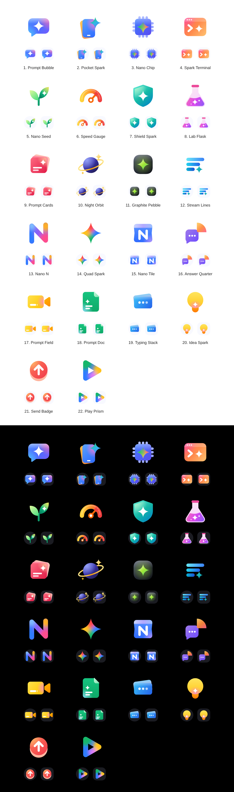

# App icon options

Twenty-two icon concepts in the style of Google's 2025 icon refresh: chunky rounded shapes,
saturated gradients with soft colour blooms, and simple white glyphs.



| Option | Idea |
| --- | --- |
| [1. Prompt Bubble](option-1-prompt-bubble.svg) | A chat bubble carrying the sparkle: prompt anything. |
| [2. Pocket Spark](option-2-pocket-spark.svg) | A phone on a stacked card with a sparkle: AI right on your phone. |
| [3. Nano Chip](option-3-nano-chip.svg) | A chip with a multicolour sparkle: Gemini Nano runs on-device. |
| [4. Spark Terminal](option-4-spark-terminal.svg) | Sunset coral and orange prompt window with a sparkle cursor. |
| [5. Nano Seed](option-5-nano-seed.svg) | Emerald and lime sprout: a small model that grows. |
| [6. Speed Gauge](option-6-speed-gauge.svg) | Amber to red gauge: see the speed of every answer. |
| [7. Shield Spark](option-7-shield-spark.svg) | Teal and mint shield: your prompts never leave your phone. |
| [8. Lab Flask](option-8-lab-flask.svg) | Magenta and violet flask: a playground to experiment in. |
| [9. Prompt Cards](option-9-prompt-cards.svg) | Rose and coral stack of prompt cards. |
| [10. Night Orbit](option-10-night-orbit.svg) | Indigo planet with a gold sparkle moon. |
| [11. Graphite Pebble](option-11-graphite-pebble.svg) | Charcoal tile with an electric lime sparkle. |
| [12. Stream Lines](option-12-stream-lines.svg) | Ocean cyan lines streaming in, ending in a sparkle. |

Options 13 to 22 follow Google's icon construction more literally, each borrowing one
technique from a specific Google icon ([preview](preview-google-style.png)).

| Option | Borrowed from | Idea |
| --- | --- | --- |
| [13. Nano N](option-13-nano-n.svg) | Gmail M | One chunky N stroke whose colour flows blue to pink to orange. |
| [14. Quad Spark](option-14-quad-spark.svg) | The G | A sparkle with one Google colour per arm, blended at the core. |
| [15. Nano Tile](option-15-nano-tile.svg) | Calendar | A pinched tile with a lighter top band and a white N. |
| [16. Answer Quarter](option-16-answer-quarter.svg) | Voice | A speech bubble with a quarter circle over its corner. |
| [17. Prompt Field](option-17-prompt-field.svg) | Meet | An input box and a send wedge, with a pink glow where they meet. |
| [18. Prompt Doc](option-18-prompt-doc.svg) | Docs | A page with a lighter fold, a sparkle and lines low on the left. |
| [19. Typing Stack](option-19-typing-stack.svg) | Slides | A tilted back card under a front card with typing dots. |
| [20. Idea Spark](option-20-idea-spark.svg) | Keep | A bulb with a pink glow at its neck and a sparkle filament. |
| [21. Send Badge](option-21-send-badge.svg) | Tasks | A disc on a lighter layer that peeks out below, with a send arrow. |
| [22. Play Prism](option-22-play-prism.svg) | Drive | A play triangle band with colours blending at the corners. |

Each option has a 512 x 512 SVG and a transparent PNG. `preview.png` shows them large and
inside circle and squircle launcher masks.

```bash
# needs Node and Playwright with Chromium
NODE_PATH=$(npm root -g) node store-listing/icon-options/generate.cjs
```
